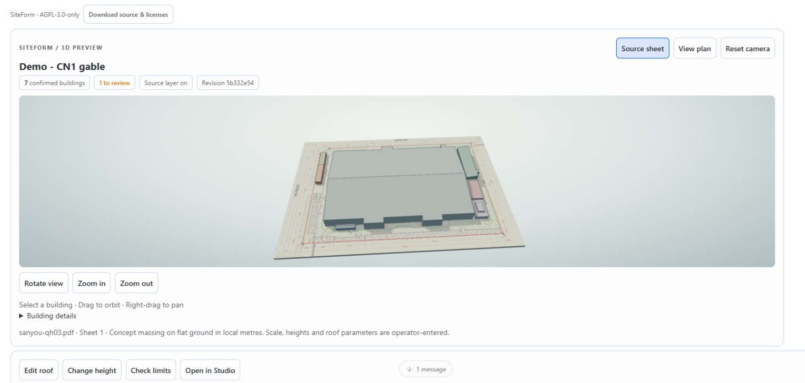

# SiteForm 0.15.0

SiteForm turns a reviewed planning PDF into an inspectable 3D concept model inside Hermes Desktop. It keeps the original drawing, measured geometry, and assumptions together.

**A geometry engine and drawing workspace for your Hermes conversations.**
Ask for a named design alternative, inspect its real 3D model in the answer,
check supplied limits, and open the same saved revision in Studio.



- **21 native tools:** import and review PDFs, build models, compare immutable
  options, evaluate bounded height/position studies and review source quantities.
- **Inline interaction:** orbit, plan view, building evidence, roof/height edits,
  concept checks and revision-linked exports directly from the chat card.
- **A connected Studio:** review source geometry, preserve editor drafts and open
  the exact drawing, option and building selected in chat.
- **Hermes model access:** chat uses the configured Hermes model. Optional quantity
  interpretation uses the public plugin LLM interface; no separate model key or
  dedicated public SiteForm server is required.

The model is reviewed concept massing. Scale, outlines, heights and illustrative
roof assumptions require confirmation; this is not automatic BIM reconstruction.

## Quick start

Use Hermes **0.22.7 or later** with its managed Python dependencies available.
Before catalog acceptance, install directly from this public repository:

```sh
hermes plugins install https://github.com/duclucky/siteform
```

For a repeatable install, add `--ref` followed by the exact 40-character source
commit in [catalog PR #153658](https://github.com/NousResearch/hermes-agent/pull/153658).
Install by catalog name only after acceptance.

Watch the [working demo on X](https://x.com/0xDucky1st/status/2120566068213391590).

Enable SiteForm's Agent tools and its Desktop surface under
**Capabilities → Plugins → SiteForm**. Restart the gateway when Hermes requests
it. Configure a supported model in Hermes for conversational requests; source
review and deterministic geometry also work without a model call.

Import your own PDF, mark a known ruler distance, confirm building outlines and
heights, then build and save a named option. Ask Hermes to open that option or
explore a specified roof/height alternative. A new library starts empty.

## Try it with an empty library

The repository includes an original synthetic drawing generator; it needs only
Python's standard library and does not download a third-party plan. From the
repository (or extracted source ZIP), run:

```sh
python examples/create_example.py --output-dir .test-cache/first-use
```

Use a new output directory each time; existing directories are refused. Open
`.test-cache/first-use/chat-prompt.txt`, copy the entire prompt into Hermes and
send it. It contains the absolute PDF path and the exact confirmed draft JSON.
The agent imports the PDF, creates the first working model and displays the
interactive 3D card. The configured Hermes model handles the tool calls; no
separate SiteForm API key is required.

This is explicitly synthetic concept data: two buildings, footprint sum
4,150 m², volume 44,550 m³, parcel 14,400 m² and estimated GFA 10,700 m².
Floor area is footprint × confirmed floor count, not a measured floor schedule.
If the inline card is unavailable in your Desktop version, open **SiteForm**,
select **siteform-example.pdf**, sheet 1, and view the same working model.

In Studio, save **Example baseline** using **Save working model as option**.
Then try this independent follow-up in chat:

> Use siteform_roof_study on siteform-example.pdf, page 1, with the saved
> Example baseline as the base. Save A roof study. Change only building A to an
> illustrative gable roof with 2 m rise and a 90° ridge direction. Keep its
> highest point and footprint. Report the measured volume change and show the
> saved interactive model and baseline comparison.

The Sanyou examples below describe the demo project; its third-party PDF is not
bundled. They require importing that source and saving the named baseline first.
The generated example above is sufficient to try the core workflow from scratch.

## Library quotas and safe removal

Open **Manage library and storage** in Studio to see PDF use (120 MiB per
profile), total saved options (100 per profile) and the 16-option limit per sheet.
Use **Remove option** in the option table or **Remove PDF project** in the library.
SiteForm previews the affected records and checks references before allowing an
exact-name confirmation. Download a project ZIP before removal if you need a backup.

An option cannot be removed while another saved/working model or study references
it. Archived studies also retain their baseline. Removing a PDF removes its own
models, options, studies, quantity history and Studio drafts; other supporting
PDFs stay in the library. A supporting PDF cannot be removed while another
project's quantity history references it, including superseded review snapshots.
If the library changes after preview, review and confirm a new preview.
Removal frees quota; SQLite may reuse free pages without shrinking its file.

Comparisons include floor program changes (count, floor height and use), parcel
changes, estimated GFA, coverage and FAR. Unknown metrics remain unknown and have
no numeric difference. Zero minimum clearance/setback is accepted; maximum limits
must be positive. Zero separation does not establish that overlapping buildings
are acceptable for a real project.

## Drawing workflow

1. Open **SiteForm** in the sidebar and import a PDF or choose one from the local library.
2. Choose a sheet. Use **Set scale** to mark the endpoints of a known dimension and enter its length in metres. Rotate or zoom the sheet as needed.
3. Use **Find outline** to enclose a building and inspect the candidate on the source. Closed lines and cubic Bézier paths are supported. The recognizer also joins selected orthogonal dashed outlines. Use **Trace outline** for a scan or for linework that cannot be closed. Enter the ID, maximum height, and optional printed footprint area.
4. Select **Flat massing**, **Gable**, **Single slope**, or **Stepped mass**. For a pitched roof, enter its rise and direction. The gable direction follows the ridge. The single-slope direction points uphill. Both are measured clockwise from the right edge of the source sheet. For a stepped mass, enter the upper tier height and its scale as a percentage of the lower footprint. Stepped masses require a convex footprint. Mark whether the form is illustrative or entered from a drawing and add the drawing reference when applicable.
5. Select **Build 3D model**. Use the aligned **Source sheet** in 3D and **View plan** in 2D. Select a building to inspect or focus it. A footprint area difference of 1% or more is flagged for review.
6. Use **Save working model as option** before exploring a change. Compare snapshots against the working model by summed footprint and enclosed volume, maximum height, and review flags. **Copy option into editor** creates an editable draft. Build to update the working model.
7. Select **Export glTF** or **Export evidence JSON** for the model you are viewing and choose an output folder. The glTF 2.0 text file embeds its buffers and uses metres. JSON records the source SHA-256, ruler, outlines, dimensions, assumptions and totals. Hermes scopes export to the chosen folder and prevents overwriting an existing file.

The native toolset works independently of Desktop. `siteform_import_pdf` imports an explicitly user-selected local PDF by absolute path. `siteform_documents`, `siteform_review_pdf`, `siteform_detect`, `siteform_scene` and `siteform_options` list sources, inspect geometry and retrieve measured model and option evidence. The agent also has `siteform_create`, `siteform_propose` and `siteform_compare`. `siteform_detect` accepts `[left, top, right, bottom]` normalized to the displayed source page before Desktop-only rotation.

## Hermes chat

Inline 3D cards include **Edit roof**, **Change height**, **Check limits** and
**Open in Studio**. Pick a building, enter the new dimensions and name, and save
an alternative. The base snapshot and working model remain unchanged. Height
edits keep the existing roof; roof edits keep the highest point. The card shows
the saved result and its comparison. **Back to chat result** restores the original
card without changing the transcript.

Select a building and choose **Open building in Studio** to open its exact PDF,
sheet, option and revision with that building focused. Studio preserves an
existing editor draft; **Copy option into editor** is an explicit action.
**Return to originating chat** reopens the original conversation. Context is scoped
to the current connection/profile and expires after one hour. Missing or stale
models display an error instead of substituting another scene.

Use **Review project quantities and supporting documents** below the PDF library
to import a supporting report and select a source page. **Read source quantities**
extracts supported embedded-text rows with their page boxes. Select Vietnamese
or English number formatting. Open **View source** to inspect a row, choose the
facts to confirm, and select the floor-area numerator and parcel-area denominator
for FAR. The confirmed result preserves the selected counting basis. Model floor
area remains an estimate using footprint × floor count.

Use **Add from source row** for a quantity or floor group the recognizer missed.
Enter the number exactly as printed, its quantity type, subject and counting
basis. SiteForm verifies the number, unit and quotation against the chosen PDF
row before saving the suggestion. Individual floor outlines require their own
geometry.

In chat, ask `siteform_project_review` to open a review by drawing name, or supply
selected supporting PDF pages to read. `siteform_confirm_facts` saves the facts
and FAR basis you explicitly chose. The returned quantity card can open source
crops, confirm facts and download a PDF report. **Interpret with Hermes** inserts
a request into the originating composer. When sent, interpretation uses Hermes's
configured model and credentials through the public plugin LLM interface, sending
only the selected page text rows. Model suggestions require the same source
validation and confirmation. If inference fails, local suggestions remain usable.
Model interpretation is bounded to the first 80 rows of a selected page or region.

Quantity reviews are immutable and profile-scoped. The latest review also opens
from the source drawing's workspace. Project ZIP version 2 includes saved reviews
and supporting source PDFs. Version 1 archives continue to restore. A profile can
retain 64 review snapshots, with up to 128 facts and 16 selected source pages or
regions per review.

Use the model configured in Hermes to control SiteForm through its native tools. The `siteform_roof_study` tool resolves a library PDF and baseline by name, saves an illustrative roof option, and returns a formatted volume comparison in English or Vietnamese. Try asking Hermes to use the saved `sanyou-qh03.pdf` and **Sanyou roof and terrace concept** baseline, save **CN1 ridge study** with a 5 m gable rise and a 90° ridge direction, and report the volume change. The tool preserves the baseline height and footprint and leaves the working model intact. Then select the named option in Desktop. Use **Refresh options** if the panel was already open. Roof assumptions and revision provenance travel with the option.

With a new sheet, Hermes can create a first working model once the user confirms the ruler endpoints and length, reviewed vector candidates or traced corners, building IDs and heights. Later chat changes create separate named options. The preview, geometry calculations, evidence and export use the same local profile data.

Hermes Desktop can show the exact saved model in the conversation. The tool returns a transcript directive for Hermes to include after its reply. The preview supports orbit, zoom, building selection, a plan view, and the original PDF layer. A named option remains bound to its saved snapshot. A working-model preview checks its original revision before displaying it.

Ask Hermes to open one existing option or compare two saved options by name with `siteform_view_options`. The comparison card shows volume, footprint, height, building count and area flags. Use **View saved option** to switch between the two snapshots. **Export glTF** and **Export evidence JSON** write the currently displayed snapshot to a folder you choose.

Use `siteform_revise_option` to save confirmed height or roof changes to several buildings as one option. A height-only edit can keep the existing roof. The original model and footprints are preserved. A chat comparison includes **Building changes** with measured differences. Select a building in that table to inspect it in the displayed model.

Ask Hermes to check a named option against supplied height, summed footprint, summed volume or building clearance limits. `siteform_check` returns measured findings and an inline card. You can also open **Check design limits** on a model card or in the SiteForm workspace. Select a finding's building ID to inspect the model. Clearance is horizontal edge-to-edge. Zero indicates footprints touching or overlapping. These are concept checks using the limits you enter.

In **View plan**, select **Measure distance** and mark two points to read their horizontal distance in metres. **Export building CSV** writes a spreadsheet-ready building schedule with dimensions, roof assumptions, source sheet and revision for the displayed model.

## Position studies

Confirm a parcel and exclusions in the drawing editor, build the model, and save
an option. Select that option and open **Explore building positions**. Choose one
building, enter the project setback and building clearance in metres, and specify
X/Y offset grids. Positive X follows sheet right and positive Y follows sheet
down. Each axis accepts 1–9 positions and must land exactly on its maximum.

SiteForm tests at most 81 positions. It checks every building against the parcel,
setback, exclusions, overlap and clearance, then ranks up to five feasible changes
by least movement within the supplied grid. The plan preview highlights the
parcel buildable region after the setback and exclusions. The trace identifies
the buildings responsible for rejected positions, including fixed buildings.
An empty or split inset is supported.

Preview a candidate in plan or 3D and explicitly save it as a named option.
The drawing outline and its candidate identity remain the source evidence, with
the design translation stored separately. Copying an option into the editor
retains that placement and provides **Reset design placement**. Saved comparisons
and CSV exports include movement information.

In chat, use `siteform_position_study` with a saved baseline and supplied limits,
then `siteform_save_position_option` after selecting a rank and name. Open the
resulting card from the returned preview. `siteform_position_studies` lists or
reopens saved studies. These native operations also run with Desktop closed.
The study library is available in the position explorer. Version 3 project ZIPs
retain position studies and recompute their rankings during restore. Earlier
archive versions continue to restore.

Position studies evaluate translations on a flat concept model. The parcel region
is a geometric guide. Individual candidate checks use the modeled boundaries and
the supplied assumptions. Results describe the tested grid and user-entered limits.

## Height studies

Ask Hermes to explore height alternatives for one or two buildings in a saved option. Give a minimum, maximum and step for each, plus a maximum project height, total enclosed volume, or both. For example, use the saved **Sanyou roof and terrace concept**, try CN1 at 11–15 m and CN2 at 5–9 m in 1 m steps, and keep the site under 177,000 m³ and at most 15 m high.

SiteForm evaluates every combination and ranks up to five feasible changes by retained volume, then lower peak height. The chat card lists each tested combination and its outcome. Preview the baseline and any ranked model in 3D, then choose a name and save the selected candidate if desired. The saved option retains the study ID, limits and chosen rank. The native tools also support searching and saving when Desktop is closed.

Each range must land exactly on its maximum and contain 2–9 heights. A profile can store 64 distinct studies. Search keeps the original footprints and roof form parameters fixed and ranks only the supplied height grid.

## Drawing review and project recovery

Mark the primary ruler on the sheet. Use **Refine primary start** or **Refine
primary end** to inspect the source at higher magnification. Click the crop or
use the arrow keys to move the marker. On vector drawings, **Snap to nearest
PDF vertex** proposes a nearby endpoint for review. Use **Apply point** to keep
the change. **Check scale** uses a second known segment and displays its
measured distance and percentage difference before you build the model.

Use **Find outline** on a region with fragmented CAD strokes. Compatible solid
strokes are joined when each endpoint has one partner within 0.25 PDF points.
Review the **Joined strokes** candidates against the source before choosing one.
Distinct colors and line widths stay separate.

Use **Select height table** and mark a region containing the complete height row,
including its label, number and metre unit. Local OCR removes long table rules
before reading the crop. Review the proposed height and its map marker, then
confirm it for the building. For an unkeyed height row, SiteForm suggests a map
association when the source legend identifies one building. You can also enter a
building ID and explicitly assign the row. The source crop travels with the saved
model and remains available in **Drawing evidence**.

- **Working drafts.** SiteForm recovers the selected sheet, unsaved dimensions, and unfinished traces on the same Desktop connection and profile. Editor saves check the opened revision. When another editor has saved, load the latest revision and review your retained draft before applying it.
- **Context in chat.** Select a building and use **Ask about building** to place its source, option and revision in the originating composer. Review and send the draft yourself. **Change height** opens the inline alternative editor. **Drawing evidence** highlights the footprint and an accepted label when available. Equal-scale option comparisons can overlay the other model as orange edges.
- **Parcel and program.** Trace the parcel and any exclusions on the source. Enter confirmed floor counts, typical floor height and use where known. Coverage uses the union of the footprint area inside the parcel. Concept gross floor area sums footprint × floor count, including overlaps in separate buildings. FAR divides that estimate by parcel area. Missing inputs are shown as unknown. Concept checks accept user-entered setback, coverage and FAR limits.
- **Architecture.** Flat massing supports interior courtyard voids. Confirmed floor levels appear as bands. Stepped massing provides a bounded upper tier for convex footprints. Height studies can prioritize retained volume, lowest peak or least height change and preserve confirmed floors.
- **Deliverables.** Open **Check design limits** to download a PDF tied to the displayed revision and last completed check. Download a project ZIP for a sheet to transfer its source PDF, working model, options and studies. **Restore project ZIP** verifies hashes, geometry and study rankings. Existing conflicting models or options are refused. The study library can reopen, archive and restore a study without breaking links in chat.
- **Assisted intake.** **Find drawing labels** reads embedded PDF text. **Read scan with local OCR** processes the selected sheet on the gateway with bundled English and Vietnamese language data. The parser suggests explicit ID and height labels such as `CN1 H=16.25 m`. Locate and confirm each label before saving. Use **Queue multiple outlines** for several vector candidates and **Check scale** for a second known segment.

Local OCR is advisory. Scan outlines still need tracing. Height suggestions require an explicit unit and supported label format. The geometry uses one primary scale per sheet. The independent check warns when the discrepancy exceeds 2%. A project ZIP restores the selected sheet's SiteForm data, not an entire Hermes profile or a chat transcript. Archiving a study hides it from active work and retains it within the storage quota.

## Installation and development

Use Hermes 0.22.7 or later. Copy the `siteform` directory to `<HERMES_HOME>/plugins/siteform`, enable it in Hermes and restart the gateway when prompted. Enable its Desktop surface from **Capabilities → Plugins → SiteForm** if needed.

The committed `desktop/plugin.js` bundles Three.js and its glTF exporter. React and the Desktop SDK resolve from Hermes. To rebuild it, install the development packages from `desktop/package.json` in that directory and run `npm run build`.

## Access and privacy disclosures

- **Files:** imports read the PDF path explicitly supplied by the user, then keep
  a copy in the active profile's plugin data directory. Export and source-download
  controls use Hermes's folder/save bridge. Project archives contain the selected
  sheet's source and SiteForm data; review their contents before sharing.
- **Model/network access:** chat requests use the user's configured Hermes
  provider. Optional quantity interpretation sends the selected text rows
  (bounded to 80 rows per selected page/region) through `ctx.llm`. SiteForm does
  not contact a separate SiteForm service, maps API or analytics endpoint.
- **Credentials:** the plugin does not read credential files or store model keys.
  Authentication and model selection belong to Hermes.
- **Execution:** no independent daemon, scheduled task, shell command or
  self-updater is started by SiteForm. Geometry, storage and optional local OCR
  run on the Hermes gateway, including when Desktop is closed.
- **Telemetry:** no telemetry or usage reporting is implemented.

## Demo source and reproducibility

The demo uses the publicly accessible
[Sanyou 1:500 planning drawings, Huế](https://huongtra.hue.gov.vn/Portals/45/Uploads/H57.108/Nam2025/Thang10/BV_251012_SAN_Planning_1_500.pdf),
QH-03 (PDF page 3). The demonstration project's ruler, outlines and height schedule
were reviewed in advance. The original full PDF SHA-256 is
`ca9270b72bacb1199f873bd48180fc45d01ec9a342848da97f0c13d318d0bae1`.
A redistribution license for the drawing was not established, so the repository
links to the source and does not bundle the PDF or the populated demo database.
Source images in the demo illustrate the review workflow; pitched roofs are
explicitly illustrative. Inference waits may be shortened in the edited video.

## Boundaries

The library accepts unlocked PDFs up to 30 MiB and 30 sheets, with 120 MiB of source PDFs per profile. There are up to 40 buildings per model and 16 saved options per sheet. Hermes permits up to 4 MiB per text export. Cubic curves are approximated by chords with a 0.25 PDF-point flatness bound before rounding. Geometry uses a local, flat ground plane. Heights, roof forms, and ruler distances are supplied by the operator. Footprint and volume totals sum individual buildings, so overlaps contribute more than once. The workflow is intended for concept review. The plugin's geometry and storage run locally. Chat uses the model configured in Hermes.

PyMuPDF is available under AGPL-3.0 and an Artifex commercial license. Review the applicable license before distributing the plugin. Three.js uses the MIT license, included in `desktop/THREE-LICENSE`. English and Vietnamese OCR data come from the Apache 2.0 [Tesseract tessdata_fast 4.1.0 release](https://github.com/tesseract-ocr/tessdata_fast/tree/4.1.0), with its license in `tessdata/LICENSE`. Shapely handles polygon operations locally.

## License and source

Original SiteForm code is **AGPL-3.0-only**. See [LICENSE](LICENSE), [NOTICE](NOTICE),
[third-party notices](THIRD_PARTY_NOTICES.md) and [source build instructions](SOURCE_BUILD.md).
The studio and inline chat cards include **Download source & licenses**, which
offers the installed source and build materials without user project data.
Third-party components retain their own licenses.

## Verification

See [portable test instructions](tests/README.md). Windows CI runs the real local
storage/REST/geometry/archive suites, rebuilds the preferred Desktop source and
checks its committed bundle and source inventory. It needs no provider key.
