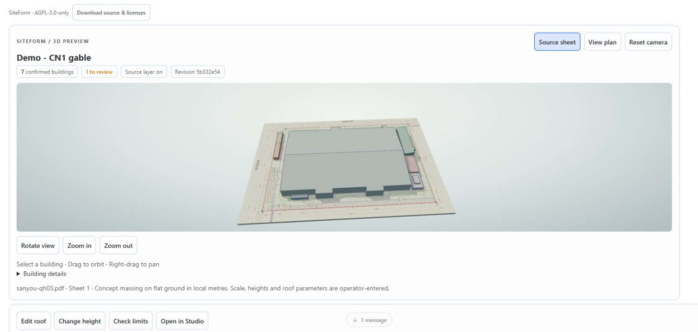
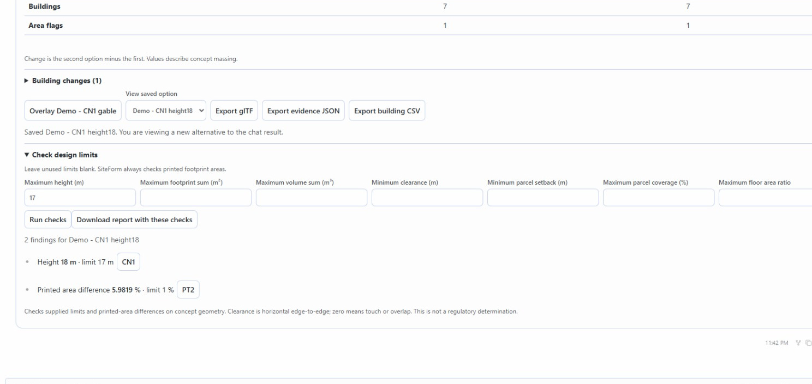
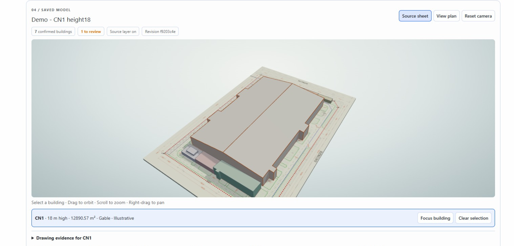

# Recorded demonstration

The release demonstration is recorded in the real Hermes Desktop with SiteForm
0.14 and the configured OpenAI gpt-5.4 provider. It starts with a prepared,
reviewed public drawing. It shows a model-driven saved roof alternative, measured
comparison, inline 3D/orbit/plan interaction, direct height editing, supplied-limit
checks and exact-option Studio navigation. Inference waits are shortened in the
edited video. English narration is synthesized, rather than a recording of the
author's voice. No product UI or measurement result is fabricated.

The original drawing is linked and attributed in the project README; it is not
included in this repository. This plugin is a concept-review tool, not certified
BIM reconstruction or a regulatory compliance determination.

Version 0.14.1 adds the API descriptor to source/release packages for fresh
installations; the recorded UI and geometry behavior are unchanged.
